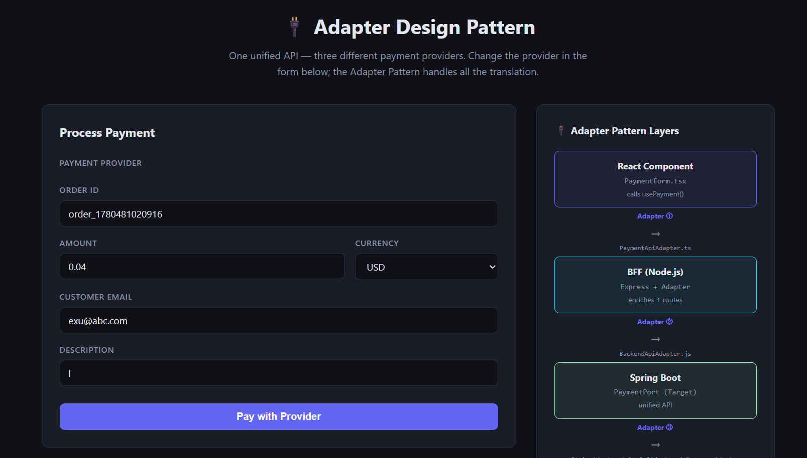
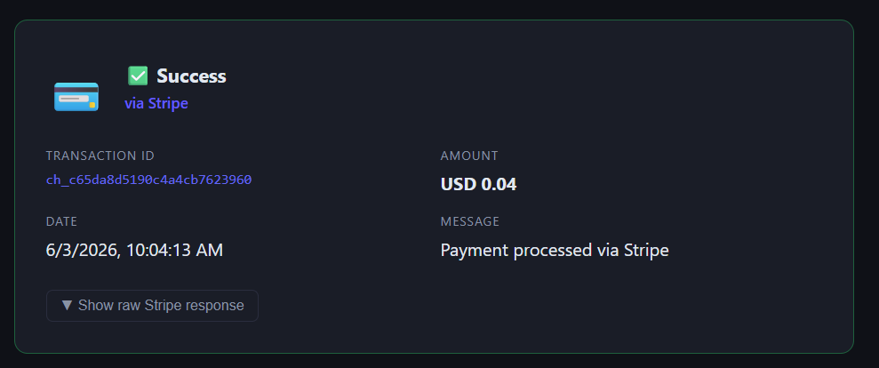

# 🔌 Adapter Design Pattern — Full-Stack Demo

A production-style demonstration of the **Adapter Design Pattern** across three
technology layers: **Spring Boot + Gradle** (Java backend), **Node.js** (BFF), and
**React + TypeScript** (frontend).

---

## 🏗️ Architecture Overview

```
┌──────────────────────────────────────────────────────────────────────────────┐
│                        Adapter Pattern — 3 Layers                            │
│                                                                              │
│  React (port 4000)                                                           │
│  └─ PaymentForm.tsx                                                          │
│       │ calls usePayment() hook                                              │
│       ▼                                                                      │
│  [ADAPTER ①] PaymentApiAdapter.ts  ←── translates React ↔ BFF API          │
│       │ HTTP POST /api/payments/process                                      │
│       ▼                                                                      │
│  Node.js BFF (port 3000)                                                     │
│  └─ payment.routes.js                                                        │
│       │ validates & proxies                                                  │
│       ▼                                                                      │
│  [ADAPTER ②] BackendApiAdapter.js  ←── enriches Spring Boot responses       │
│       │ HTTP POST http://backend:8080                                        │
│       ▼                                                                      │
│  Spring Boot (port 8080)                                                     │
│  └─ PaymentController                                                        │
│       │ calls PaymentService                                                 │
│       ▼                                                                      │
│  [TARGET] PaymentPort (interface)  ←── the unified abstraction              │
│       │                                                                      │
│  ┌────┴──────────────────────────────────────────┐                          │
│  │              PaymentAdapterFactory            │                          │
│  └──┬──────────────────┬────────────────────┬───┘                          │
│     ▼                  ▼                    ▼                               │
│  [ADAPTER ③]      [ADAPTER ③]         [ADAPTER ③]                          │
│  StripeAdapter   PayPalAdapter     RazorpayAdapter                          │
│     │                  │                    │                               │
│  StripeSdk         PayPalSdk          RazorpaySdk                           │
│  (Adaptee)         (Adaptee)          (Adaptee)                             │
└──────────────────────────────────────────────────────────────────────────────┘
```

---

## 📁 Project Structure

```
adapter-pattern-demo/
│
├── backend/                          ← Spring Boot + Gradle (Java 17)
│   ├── build.gradle
│   ├── settings.gradle
│   ├── Dockerfile
│   └── src/main/java/com/adapter/demo/
│       ├── AdapterPatternDemoApplication.java
│       │
│       ├── port/
│       │   └── PaymentPort.java              ← TARGET interface
│       │
│       ├── adapter/
│       │   ├── StripeSdk.java                ← ADAPTEE (3rd-party simulation)
│       │   ├── PayPalSdk.java                ← ADAPTEE (3rd-party simulation)
│       │   ├── RazorpaySdk.java              ← ADAPTEE (3rd-party simulation)
│       │   ├── StripePaymentAdapter.java     ← ADAPTER (Stripe → PaymentPort)
│       │   ├── PayPalPaymentAdapter.java     ← ADAPTER (PayPal → PaymentPort)
│       │   └── RazorpayPaymentAdapter.java   ← ADAPTER (Razorpay → PaymentPort)
│       │
│       ├── config/
│       │   └── PaymentAdapterFactory.java    ← Adapter registry/factory
│       │
│       ├── service/
│       │   └── PaymentService.java           ← Business logic (uses Port only)
│       │
│       ├── controller/
│       │   ├── PaymentController.java        ← REST endpoints
│       │   └── GlobalExceptionHandler.java
│       │
│       └── model/
│           ├── PaymentRequest.java           ← Unified request model
│           └── PaymentResponse.java          ← Unified response model
│
├── bff/                              ← Node.js BFF (Express)
│   ├── package.json
│   ├── .env.example
│   ├── Dockerfile
│   └── src/
│       ├── index.js                          ← Express app entry
│       ├── adapters/
│       │   └── backendApiAdapter.js          ← ADAPTER ② (enriches responses)
│       ├── routes/
│       │   └── payment.routes.js             ← Express routes + validation
│       └── middleware/
│           └── errorHandler.js
│
├── frontend/                         ← React + TypeScript (CRA)
│   ├── package.json
│   ├── Dockerfile
│   └── src/
│       ├── App.tsx
│       ├── types/
│       │   └── payment.types.ts              ← Shared TypeScript interfaces
│       ├── adapters/
│       │   ├── paymentApiAdapter.ts          ← ADAPTER ③ (React ↔ BFF)
│       │   └── mockPaymentApiAdapter.ts      ← Test mock (same interface)
│       ├── hooks/
│       │   └── usePayment.ts                 ← Custom hooks (use adapter)
│       ├── components/
│       │   ├── payment/
│       │   │   ├── PaymentForm.tsx           ← Payment form UI
│       │   │   └── PaymentResult.tsx         ← Result display
│       │   └── ui/
│       │       └── AdapterDiagram.tsx        ← Visual architecture diagram
│       ├── pages/
│       │   └── HomePage.tsx
│       └── styles/
│           └── index.css
│
├── docker-compose.yml
└── README.md
```

---

## 🔑 Key Pattern Roles

| Role | Spring Boot Class | What it does |
|---|---|---|
| **Target** | `PaymentPort` | The interface our app depends on |
| **Adaptee** | `StripeSdk`, `PayPalSdk`, `RazorpaySdk` | Incompatible 3rd-party SDKs |
| **Adapter** | `StripePaymentAdapter`, etc. | Bridges Target ↔ Adaptee |
| **Client** | `PaymentService` | Uses only the Target interface |
| **Factory** | `PaymentAdapterFactory` | Resolves adapter by name at runtime |

### Adapter translations performed

| Adapter | Key translations |
|---|---|
| **StripePaymentAdapter** | dollars → cents (×100), `"succeeded"` → `"SUCCESS"` |
| **PayPalPaymentAdapter** | builds nested `purchase_units[]`, `"COMPLETED"` → `"SUCCESS"` |
| **RazorpayPaymentAdapter** | amount → paise (×100), builds `notes{}`, `"captured"` → `"SUCCESS"` |
| **BackendApiAdapter.js** | adds `providerLabel`, `icon`, `color`, `formattedAmount` for UI |
| **PaymentApiAdapter.ts** | TypeScript wrapper, hides axios, one place for all API calls |

---

## 🚀 Running the Project

**Demo only:** All three payment SDKs are local simulations. No real payments or refunds are processed. Amounts currently use `double` in the demo API; do not use this as production payment-processing code without exact decimal handling, request validation, security, and real provider integration.

### Prerequisites
- Java 17+, Gradle 8+
- Node.js 20+
- Docker + Docker Compose (optional)

### Option 1 — Docker Compose (all services)
```bash
docker-compose up --build
# Frontend → http://localhost:4000
# BFF      → http://localhost:3000
# Backend  → http://localhost:8080
# Swagger  → http://localhost:8080/swagger-ui.html
```

### Option 2 — Manual (3 terminals)

For the BFF, copy `bff/.env.example` to `bff/.env` and adjust `BACKEND_URL` if needed. The `.env` file is deliberately ignored by Git.

**Terminal 1 — Spring Boot**
```bash
cd backend
./gradlew bootRun
# Starts on http://localhost:8080
```

**Terminal 2 — Node.js BFF**
```bash
cd bff
npm install
npm run dev
# Starts on http://localhost:3000
```

**Terminal 3 — React Frontend**
```bash
cd frontend
npm install
npm start
# Starts on http://localhost:4000 (or 3001 if 3000 is taken)
```

---

## 🧪 Testing

### Backend (JUnit 5 + Mockito)
```bash
cd backend
./gradlew test
```

### BFF (Jest)
```bash
cd bff
npm test
```

### Frontend (build check)
```bash
cd frontend
npm ci
npm run build
```
There are currently no frontend component tests. The CI build verifies TypeScript/React compilation.

---

## 📡 API Reference

All endpoints available via Swagger UI at `http://localhost:8080/swagger-ui.html`

| Method | URL | Description |
|---|---|---|
| `POST` | `/api/payments/process` | Process payment (any provider) |
| `POST` | `/api/payments/{provider}/refund/{txId}?amount=X` | Refund |
| `GET` | `/api/payments/{provider}/status/{txId}` | Check status |
| `GET` | `/api/payments/providers` | List available providers |

### Example — same request, different provider

```json
{
  "orderId": "ord_001",
  "amount": 99.99,
  "currency": "USD",
  "customerEmail": "user@example.com",
  "description": "Premium plan",
  "provider": "stripe"
}
```
Change `provider` to `paypal` or `razorpay` to select a different adapter. Use a compatible currency for the provider.

---

## 💡 Why the Adapter Pattern?

The three payment SDKs are fundamentally incompatible:

```
Stripe:   createCharge(amountInCents, currency, email, ...)  → { id, status: "succeeded" }
PayPal:   createOrder("CAPTURE", purchaseUnits[], email)     → { id, status: "COMPLETED" }
Razorpay: createPayment(amountInPaise, currency, receipt, ..)→ { id, status: "captured" }
```

Without the Adapter Pattern, `PaymentService` would be littered with `if/else` blocks.
With it, the service calls one unified `PaymentPort.processPayment()` and the adapters
handle all translation. Adding a new gateway (e.g. Braintree) means:

1. Integrate a (simulated) `BraintreeSdk.java` or other provider SDK
2. Write `BraintreePaymentAdapter.java` (implements `PaymentPort`)
3. **Zero changes** to `PaymentService`, `PaymentController`, or any other class ✅



